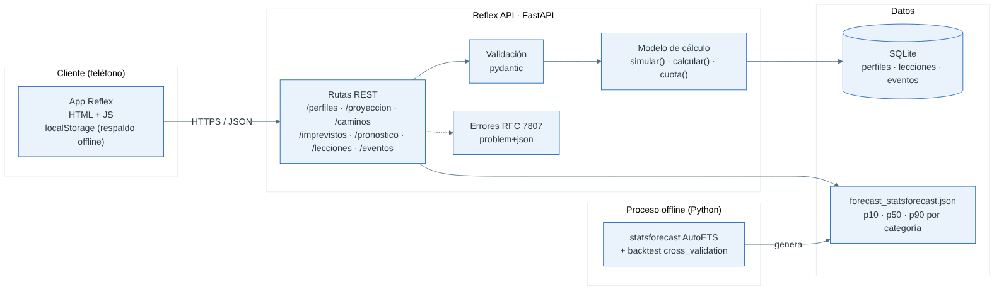

# Reflex API

Backend del prototipo **Reflex** (Desafío Bci Labs · Taller de Interacción IV). Calcula en cuántos meses una persona junta el pie de su vivienda, cuánto pesaría la cuota y cómo cambia el plan ante imprevistos. *No es una oferta de Bci.*



## Arquitectura

| Capa | Qué hace | Tecnología |
|---|---|---|
| Cliente | App de teléfono (HTML + JS). Guarda el avance en `localStorage` para funcionar sin conexión. | HTML/CSS/JS |
| Servicios | API REST con validación de entrada, errores estándar y medición de latencia (`Server-Timing`). | FastAPI + pydantic |
| Modelo | Funciones puras `simular()`, `calcular()`, `cuota()`; traducción 1:1 del modelo de la app. | Python |
| Datos | Perfiles, progreso de lecciones y eventos de los tests de usabilidad. | SQLite |
| Pronóstico | Gasto diario por categoría con bandas p10/p50/p90, generado offline y validado con backtest. | statsforecast (AutoETS) |

## Modelo de datos

```
perfiles   (id PK, datos JSON, creado_en, actualizado)
lecciones  (perfil_id FK→perfiles, leccion, intentos ≥0, correcta 0|1)   PK (perfil_id, leccion)
eventos    (id PK, sesion, participante, tarea T1–T4, tipo inicio|fin|error|ayuda|seq, valor, ts)
```

## Servicios

| Método | Ruta | Para qué |
|---|---|---|
| GET | `/api/salud` | Estado del servicio |
| POST | `/api/perfiles` | Crea un perfil (campos opcionales; lo que falte toma la persona tipo) y devuelve la proyección |
| GET / PATCH | `/api/perfiles/{id}` | Lee o edita el perfil |
| GET | `/api/perfiles/{id}/proyeccion` | Meses al pie, cuota, % del ingreso, nivel, serie mensual |
| GET | `/api/perfiles/{id}/caminos` | Compara *La vía rápida*, *Lento pero seguro* y *Ajustar la vivienda* |
| POST | `/api/perfiles/{id}/imprevistos` | Cuántos meses atrasa un imprevisto (`salud`, `auto`, `hijo`, `hogar`, `arriendo`, `ingreso`) |
| GET | `/api/pronostico/{cat}` | Bandas p10/p50/p90 (`ali`, `del`, `otr`, `com`) |
| GET / POST | `/api/perfiles/{id}/lecciones` | Progreso en *Aprende* |
| POST | `/api/eventos` · GET `/api/eventos/{sesion}/resumen` | Registro de tareas del test: tiempo, éxito, errores, SEQ |

Documentación interactiva (OpenAPI): `http://localhost:8000/docs`.

**La app conectada.** El servidor también sirve la app en `http://localhost:8000`. Al abrirla desde ahí, la app detecta la API sola: guarda el plan al llegar a la proyección y cada respuesta de *Aprende*, y muestra "Plan guardado en el servidor de Reflex". Abierta como archivo suelto, o con `?api=URL` apuntando a otro servidor, funciona igual; sin servidor sigue calculando todo en el teléfono.

Errores en formato **RFC 7807** (`application/problem+json`):

```json
{"type":"https://reflex.app/errores/404","title":"No encontrado","status":404,
 "detail":"No existe el perfil xx.","instance":"/api/perfiles/xx/proyeccion"}
```

## Correr

```bash
pip install -r requirements.txt
uvicorn app.main:app --reload          # http://localhost:8000/docs
pytest -q -s                            # 13 tests
# o con Docker
docker build -t reflex-api . && docker run -p 8000:8000 reflex-api
```

## Calidad verificada

- **13 tests** pasan (incluye que el servidor entregue la app): paridad con la app (18 / 46 / 20 meses; 27,3 / 23,5 / 18,8 %), imprevistos, lecciones, eventos, errores 404/422 y latencia.
- **Latencia** con servidor real, 200 llamadas por ruta: mediana 1,7–3,4 ms, p95 ≤ 5,5 ms (meta < 200 ms).

| Ruta | Mediana | p95 |
|---|---|---|
| POST /api/perfiles | 3,4 ms | 5,5 ms |
| GET /proyeccion | 2,1 ms | 2,5 ms |
| GET /caminos | 2,1 ms | 2,9 ms |
| POST /imprevistos | 2,2 ms | 3,1 ms |
| GET /pronostico/ali | 1,7 ms | 2,1 ms |

## Límites

Datos de gasto sintéticos (379 días); sin autenticación ni cifrado porque el prototipo no guarda datos reales. Para producción: OAuth2 con el banco, PostgreSQL, y conexión a movimientos reales con consentimiento.
